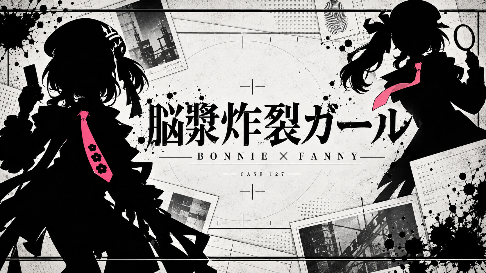

# Bonnie · 脑浆炸裂女孩 PV / V11 源码与提示词

以《星引擎派对》邦妮与芬妮为主角的非官方同人 PV 源码与提示词公开版本。黑白纸面、泼墨、调查档案、翻盖手机、放大镜和粉色领带构成主要视觉语言；镜头与文字按绝对歌曲时码绘制，使用 Canvas 2D 与 WebGL 透视文字平面。



这个包提供动画源码、真实提示词的脱敏副本、分镜和验收方法。原工程、成片、音乐、完整原歌词、角色图片、用户头像和审片截图均未包含。唯一图片是此次新生成的封面。默认预览为原创占位文字、合成节奏与程序化几何占位图，不能当作最终 PV 或像素级复现。

## 开始使用

需要 Node.js 20 或更新版本。预览不需要原素材；关键帧工具还需要 Chrome/Chromium 与 npm 依赖。

```sh
npm install
npm run doctor
npm start
```

打开终端打印的本地地址，拖动时间轴或选择章节观察构图。没有音乐时不使用有声播放按钮。可通过 `BONNIE_CHROME` 指定浏览器。程序不会下载媒体，也不调用任何图像生成 API。

## 生成演示关键帧

```sh
npm run render
npm run render -- --times=62.8333333333,70.15,157.4,181 --out=outputs/review
npm test
```

输出只写 `outputs/`。原制作使用 1920×1080、60 fps、11,495 帧；源码保留这些时间坐标，但示例中不包含可直接导出的原曲、角色和歌词。批量成片恢复需要自行提供合法素材、替换文字及检查布局，见 [使用方法](docs/USAGE.md)。

## 文档和提示词

| 文档 | 内容 |
| --- | --- |
| [使用方法](docs/USAGE.md) | 预览、环境、素材接口与复用边界 |
| [实现结构](docs/ARCHITECTURE.md) | 绝对时码、场景模块、文字平面与角色构图 |
| [提示词索引](docs/prompts/PROMPT_GUIDE.md) | 推荐顺序、真实历史与重新创作方式 |
| [总提示词](docs/prompts/MASTER_PROMPT.md) | 可复用的项目要求模板 |
| [角色与道具](docs/prompts/01_CHARACTER_ASSETS.md) | 黑剪影、领带、透明 PNG 和完整双腿 |
| [分镜与文字](docs/prompts/02_STORYBOARD_AND_TYPE.md) | 主句阅读、半透明载体、假名与背景 |
| [镜头和节奏](docs/prompts/03_CAMERA_AND_TIMING.md) | 鼓点、翻转、纸面视角、相机连续性 |
| [验收与迭代](docs/prompts/04_REVIEW_AND_EXPORT.md) | 抽帧、跳转、边界、版本保留 |
| [真实提示词历史](docs/prompts/history/README.md) | 移除路径后的历史 ImageGen 请求 |
| [素材政策](docs/ASSET_POLICY.md) / [第三方说明](docs/THIRD_PARTY_NOTICES.md) | 代码、人物、音乐、字体和封面分别说明 |
| [发布检查](docs/OPEN_SOURCE_RELEASE.md) | 上传前白名单、隐私和校验 |

## 目录

```text
src/renderer/      最终 V11 渲染闭包的发布副本与占位适配
export/            原始 ACK 原始帧 WebSocket 辅助器及 MIT 署名
tools/             便携预览、环境检查与关键帧截图
data/             原创演示 cue、数字时序与合成节奏元数据
assets/            55 项外部素材接口说明；不含角色 PNG
media/             自备音乐说明；不含音视频
docs/              使用、架构、提示词、权利范围与唯一封面
outputs/           本地运行后生成，默认不提交
```

## 参考与许可

公开包布局和说明方式参考 [YouBaoWW/NancyLu-world-execute-pv](https://github.com/YouBaoWW/NancyLu-world-execute-pv)。实际复用的 `wsframes.mjs` 保留 Nyankomint 的 MIT 署名；没有复制其角色图片或音乐。

本项目自有代码与文档采用 [MIT](LICENSE)。音乐、歌词、游戏角色、商标、用户素材及生成封面的角色形象不由代码 MIT 授权覆盖。详见第三方说明。项目为非官方同人创作，与游戏或音乐权利方不存在官方合作关系。
